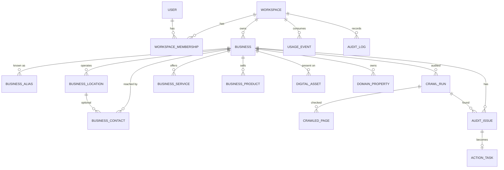

# Architecture

## Repository assessment

The repository started empty (README only), so the blueprint's recommended stack was adopted as-is:
a **Laravel modular monolith** (REST API + queue workers), **PostgreSQL**, **Redis** for queues/cache, and a
**React + TypeScript** dashboard. Microservices are deliberately avoided until crawl or AI load justifies extracting a worker.

The dashboard is a Vite SPA because it sits behind login and does not need to rank. Public, SEO-sensitive pages
(business microsites in Phase 2) will be server-rendered separately so they are fully crawlable.

## Modules (bounded contexts) in Phase 1

| Module | Where |
| --- | --- |
| Identity & auth | `AuthController`, Sanctum tokens, `User` |
| Tenancy / workspaces | `Workspace`, `WorkspaceMembership`, `ResolveWorkspace` middleware, `BelongsToWorkspace` trait, `CurrentWorkspace` |
| Roles & permissions | `App\Enums\WorkspaceRole`, `App\Enums\Permission` |
| Business identity graph | `Business`, `BusinessAlias`, `BusinessLocation`, `BusinessContact`, `BusinessService`, `BusinessProduct`, `BusinessService` (app service) |
| Digital asset registry | `DigitalAsset`, `DomainProperty`, `AssetPlatform`, `AssetScanner`, `ScanDigitalAsset` job |
| Crawler | `App\Services\Crawler\*` (`UrlGuard`, `SafeHttpClient`, `RobotsTxt`, `SitemapParser`, `HtmlAnalyzer`, `SiteCrawler`) |
| Audit engine | `WebsiteAuditRules`, `IdentityChecker`, `IssueCatalog`, `IssueRecorder`, `AuditRunner`, `RunWebsiteAudit` job |
| Action Centre | `ActionTask`, `ActionStatus`, `ActionPlanner`, `ActionController` |
| Coverage & usage | `config/findriva.php` plans, `UsageEvent`, `CoverageController` |
| Audit log | `AuditLog`, `AuditLogger` (redacts secrets) |
| Operations console | `Admin\AdminController` (platform staff only) |

Controllers stay thin; logic lives in services. Provider interfaces for keyword, SERP, Search Console, CMS and social
publishing arrive with those modules in Phases 2–3, following the same pattern as `HostResolver`.

## Data model

Every tenant-owned table carries `workspace_id`, including children, so isolation never depends on a join.

## Tenant isolation (defence in depth)

1. `ResolveWorkspace` reads `X-Workspace-Id` (or the user's last workspace), refuses non-members with 403, and runs
   **before route model binding** (priority list in `bootstrap/app.php`).
2. `BelongsToWorkspace` adds a global scope on every tenant model, so a bound `{business}` from another tenant is a 404.
   It also refuses to create a row in any workspace other than the active one.
3. Controllers re-check `workspace_id` and parent ownership (`ensureInWorkspace`, `ensureBelongs`).
4. Queued jobs carry the workspace id and re-establish the tenant with `CurrentWorkspace::runAs`, so a job given the
   wrong tenant cannot load the record (tested).

## Crawler safety

- Only `http`/`https` on ports 80/443, no credentials in URLs, no internal hostnames.
- Every address the host resolves to must be publicly routable (blocks loopback, RFC1918, link-local and cloud metadata
  `169.254.169.254`, CGNAT, IPv6 ULA/link-local, IPv4-mapped IPv6, documentation ranges).
- The connection is **pinned** to the validated IP (`CURLOPT_RESOLVE`) to defeat DNS rebinding.
- Redirects are followed manually (max 5) and **every hop is re-validated**.
- Response size (2 MB), timeouts, page budget (per plan), depth and total runtime are capped.
- robots.txt is respected; disallowed pages are recorded as blocked and never fetched. Crawl-delay honoured (capped).
- XML is parsed with `LIBXML_NONET` (no external entities). No JavaScript is executed.
- Page text is used for identity checks and then deleted; only the signals needed for the audit are stored.
- `FINDRIVA_CRAWLER_ALLOW_PRIVATE` exists for local development only and is ignored in production.

## Honesty rules built into the model

- Submission, crawling, indexing, ranking, traffic and conversions are separate concepts. The overview reports profile
  completeness, website health, fixes done and fixes verified separately and never blends them into one score.
- Search-engine data shows "not connected" until a real source is connected. Nothing is estimated or invented.
- An action becomes **verified** only when a later check no longer finds the issue. It cannot be set by hand.
- Changes on a channel the customer controls require their approval before work can start.
- `connection_state = connected` can only be set by a real OAuth flow (Phase 3), not through the API.
- We never collect passwords for Google, social or CMS accounts.

## Security notes

- Passwords hashed (bcrypt), minimum 10 characters with letters and numbers; login and registration rate-limited.
- API tokens via Sanctum; audits are rate-limited per workspace and capped per plan.
- The audit log redacts any `password`/`token`/`secret` keys; tests assert credentials never reach it.
- Platform staff can see operational data but there is no endpoint that returns integration secrets.
- Owner-only actions (workspace deletion, billing) and the last-owner rule are enforced server-side.
